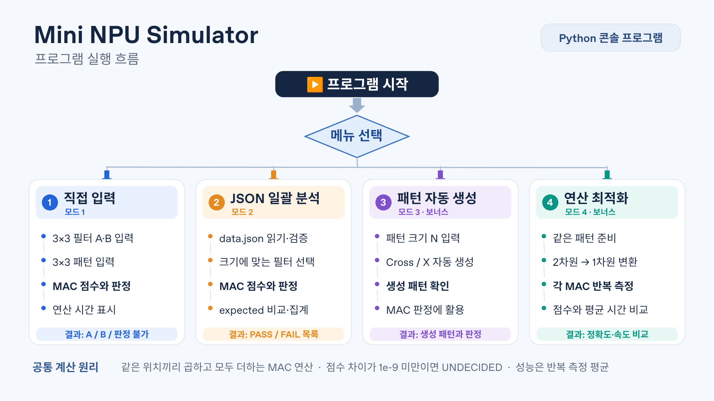
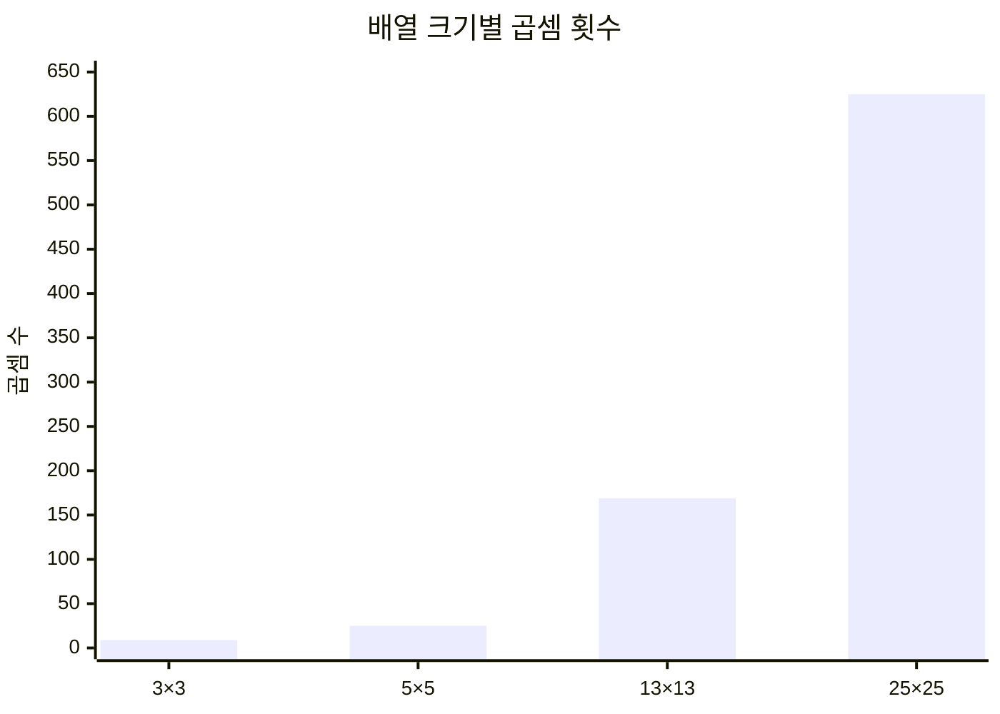

# 🧠 Mini NPU Simulator

> **숫자로 표현된 십자가(+)와 X를 구별하며 AI 연산의 기본인 MAC를 배우는 Python 프로젝트**


## 👀 30초 만에 이해하기

| 질문 | 답변 |
|---|---|
| **무엇을 만들었나요?** | 십자가와 X 모양을 숫자로 비교해 판정하는 프로그램 |
| **왜 만들었나요?** | NPU에서 중요한 곱셈·누적 덧셈(MAC) 연산 이해 |
| **입력은 무엇인가요?** | 0과 1로 표현된 2차원 배열(패턴)과 비교용 필터 |
| **어떻게 판단하나요?** | 같은 위치의 숫자를 곱해서 더하고 점수가 큰 필터 선택 |
| **검증 결과는요?** | 학습용 예제 패턴 **8/8 PASS**, 자동 검사 **8/8 OK** |
| **무엇이 아닌가요?** | 실제 NPU 칩이나 학습하는 AI 모델이 아닌 **교육용 모의실험** |

> [!IMPORTANT]
> 이 저장소의 `data.json`은 **동작 확인을 위해 작성한 학습용 예제**이며 교육기관의 공식 과제 데이터가 아닙니다. 공식 데이터가 따로 있다면 교체 후 다시 검증해야 합니다. 여기서의 PASS는 **예제 데이터에 대한 결과**입니다.

---

## 1. 컴퓨터는 모양을 어떻게 읽나요?

빈 칸(□)은 `0`, 색칠한 칸(■)은 `1`로 바꿉니다.

| 십자가(Cross) | X |
|:---:|:---:|
| □ ■ □ | ■ □ ■ |
| ■ ■ ■ | □ ■ □ |
| □ ■ □ | ■ □ ■ |
| `0 1 0` | `1 0 1` |
| `1 1 1` | `0 1 0` |
| `0 1 0` | `1 0 1` |

가로 한 줄은 **행(row)**, 세로 한 줄은 **열(column)**입니다. 3×3 모양에는 총 **9개 숫자**가 있습니다.

## 2. 프로그램 작동 순서



*위 그림은 1·2번 필수 모드와 3·4번 보너스 모드의 처리 순서를 구분한 설명용 도식입니다.*

**평가 설명:** “직접 입력하거나 JSON 파일을 읽어 패턴과 필터를 준비합니다. 같은 위치의 숫자를 곱한 후 합계를 구하고, 점수가 큰 필터로 판정합니다. 파일 모드에서는 정답과 일치하는지도 검사합니다.”

## 3. MAC 연산을 숫자로 직접 이해하기

**MAC**는 **Multiply(곱하기) + Accumulate(누적해 더하기)**의 약자입니다.

입력 패턴이 X라면:

```text
입력 X        Cross 필터        곱셈 결과
1 0 1         0 1 0            0 0 0
0 1 0    ×    1 1 1     →      0 1 0
1 0 1         0 1 0            0 0 0
```

곱셈 결과 9개를 더하면 **Cross 점수는 1.0**입니다.

```text
입력 X        X 필터            곱셈 결과
1 0 1         1 0 1            1 0 1
0 1 0    ×    0 1 0     →      0 1 0
1 0 1         1 0 1            1 0 1
```

곱셈 결과 9개를 더하면 **X 점수는 5.0**입니다.

| 비교 필터 | MAC 점수 | 의미 |
|---|---:|---|
| Cross | 1.0 | 겹치는 1이 적음 |
| **X** | **5.0** | 겹치는 1이 많음 |

따라서 **X 점수 5 > Cross 점수 1 → X 판정**입니다. 이 점수는 예제에서의 **곱셈 합계**이며 AI의 예측 확률이 아닙니다.

### 실제 MAC 코드: 한 줄씩 설명

```python
total = 0.0

for i in range(len(pattern)):
    for j in range(len(pattern[i])):
        total += pattern[i][j] * filter_matrix[i][j]

return total
```

| 코드 | 초보자를 위한 뜻 |
|---|---|
| `total = 0.0` | 합계 변수 `total`을 0에서 시작 |
| `for i in range(len(pattern)):` | 패턴의 **행(가로줄)** 수만큼 반복. `i`는 행 번호 |
| `for j in range(len(pattern[i])):` | 현재 행의 **열(칸)** 수만큼 반복. `j`는 열 번호 |
| `pattern[i][j]` | 패턴의 `i`행 `j`열에 있는 숫자 |
| `filter_matrix[i][j]` | 필터에서 같은 위치의 숫자 |
| `*` | 두 수를 곱함 |
| `total += ...` | 곱한 값을 기존 합계에 계속 더함 (`total = total + ...`) |
| `return total` | 최종 합계를 함수 호출한 곳으로 돌려줌 |

**왜 `range(3)` 대신 `range(len(pattern))`을 쓰나요?** 3×3 외에 5×5나 13×13에도 같은 코드를 사용하기 위해서입니다. 3×3에서 `len(pattern)`은 3이며 반복 번호는 `0, 1, 2`입니다.

## 4. 실행 방법과 두 가지 모드

### 개발 환경

- Python 3.8 이상, 외부 라이브러리 설치 불필요
- Python 표준 라이브러리 사용: `json`, `time`, `re`, `pathlib` 등
- `main.py`와 `data.json`은 같은 프로젝트 폴더에 배치

PowerShell에서 프로젝트 폴더로 이동한 뒤 실행:

```powershell
python main.py
```

Windows에서 `python` 명령이 없으면 `py main.py`를 시도할 수 있습니다.

```text
=== Mini NPU Simulator ===

[모드 선택]
1. 사용자 입력 (3x3)
2. data.json 분석
0. 종료
선택:
```

### 모드 1 — 3×3 직접 입력

1. 메뉴에서 `1` 입력.
2. 필터 A에 십자가 모양을 **3줄**로 입력.
3. 필터 B에 X 모양을 **3줄**로 입력.
4. 입력 패턴으로 X 모양을 **3줄**로 입력.
5. 예상: **A=1.0, B=5.0, 판정=B**.

```text
필터 A(Cross)      필터 B(X)         입력 패턴(X)
0 1 0              1 0 1             1 0 1
1 1 1              0 1 0             0 1 0
0 1 0              1 0 1             1 0 1
```

> **입력 주의:** `0 1 0`처럼 숫자 사이에 공백이 필요합니다. `010` 또는 `0 a 1`을 입력하면 오류가 표시되고 **해당 행렬을 처음부터 다시 입력**합니다.

### 모드 2 — `data.json` 자동 분석

1. 메뉴에서 `2`를 선택합니다.
2. `filters`(비교용 필터)와 `patterns`(검사할 모양)을 읽습니다.
3. `size_3`, `size_5`, `size_13`, `size_25`처럼 이름에서 크기를 읽어 맞는 필터를 선택합니다.
4. 각각의 Cross/X 점수를 계산합니다.
5. 미리 기록된 정답인 `expected`와 실제 `판정`을 비교해 PASS/FAIL을 표시합니다.

**학습용 예제에서 검증된 결과**

| 검사 대상 | Cross | X | 판정 | 기대 정답 | 결과 |
|---|---:|---:|---|---|---|
| 3×3 십자가 | 5.0 | 1.0 | Cross | Cross | ✅ PASS |
| 3×3 X | 1.0 | 5.0 | X | X | ✅ PASS |
| 5×5 십자가 | 9.0 | 1.0 | Cross | Cross | ✅ PASS |
| 5×5 X | 1.0 | 9.0 | X | X | ✅ PASS |
| 13×13 십자가 | 25.0 | 1.0 | Cross | Cross | ✅ PASS |
| 13×13 X | 1.0 | 25.0 | X | X | ✅ PASS |
| 25×25 십자가 | 49.0 | 1.0 | Cross | Cross | ✅ PASS |
| 25×25 X | 1.0 | 49.0 | X | X | ✅ PASS |

**총 8건 / 통과 8건 / 실패 0건** (학습용 예제 기준)

### 자동 검사

프로그램이 실행 중이면 메뉴에서 `0`으로 종료한 후, **`PS C:\...>`가 표시된 PowerShell에서** 실행합니다.

```powershell
python -m unittest -v
```

```text
test_close_scores_undecided ... ok
test_cross_vs_x ... ok
test_flattened_mac_invalid_length ... ok
test_flattened_mac_matches_original ... ok
test_generator_invalid_size ... ok
test_generator_recognizes_both_patterns ... ok
test_invalid_shape ... ok
test_sample_data ... ok

Ran 8 tests
OK
```

## 5. 오류를 막기 위한 장치

### 라벨 정규화 — 같은 뜻을 하나의 이름으로 통일

| 원래 표시 | 프로그램에서 사용하는 이름 |
|---|---|
| `+`, `cross`, `Cross`, `십자가` | `Cross` |
| `x`, `X` | `X` |

예를 들어 정답이 `+`로 저장되어도 내부에서는 `Cross`로 바꿔 비교합니다. **정규화**란 같은 의미의 여러 표현을 같은 형식으로 정리하는 것입니다.

### 엡실론(epsilon) — 아주 작은 차이는 동점 처리

```python
abs(score_a - score_b) < 1e-9
```

| 표현 | 의미 |
|---|---|
| `score_a - score_b` | 두 점수의 차이 |
| `abs(...)` | 차이의 절댓값(부호와 관계없는 크기) |
| `1e-9` | `0.000000001` |
| `UNDECIDED` | 두 점수 차이가 이 값보다 작아 판정을 보류 |

소수 계산에서는 미세한 오차가 발생할 수 있어 이런 비교 기준을 사용합니다. JSON의 잘못된 개별 입력은 `FAIL`과 이유를 기록하고 다른 패턴 분석을 계속합니다.

## 6. 성능 분석: N이 커지면 얼마나 계산할까요?

| 배열 크기 | 칸 수 = 곱셈 수 `N²` | 3×3 대비 |
|---|---:|---:|
| 3×3 | 9 | 1배 |
| 5×5 | 25 | 약 2.8배 |
| 13×13 | 169 | 약 18.8배 |
| 25×25 | 625 | 약 69.4배 |



- `N`은 한 변의 칸 수이며, 가로 N칸 × 세로 N칸 = **`N²`개의 곱셈**을 수행합니다.
- 핵심 MAC 계산의 **시간 복잡도는 `O(N²)`**: 한 변이 2배면 확인할 위치가 약 4배가 됩니다.
- 프로그램은 각 크기의 MAC를 **10회 실행해 평균 시간(ms)**을 측정합니다.
- **시간은 컴퓨터 성능과 실행 환경에 따라 변합니다.** 곱셈 수는 고정이지만 측정 시간은 고정되지 않습니다.
- 현재 예제 `data.json`은 **3×3·5×5·13×13·25×25**에 각각 Cross·X 정답 패턴 2개씩 포함합니다. 이는 공식 과제 데이터와 구별됩니다.
- 실제 NPU는 대량의 MAC를 효율적으로 수행하는 장치이며, 이 프로젝트는 **NPU를 직접 구동하거나 인공지능을 학습시키지는 않습니다.**

## 7. 프로젝트 파일과 Python 용어

```text
mini-npu-simulator/
├── main.py        # 입력·MAC 계산·판정·성능 분석
├── data.json      # 학습용 예제 필터·패턴
├── test_main.py   # 자동 검사 코드
├── create_sample_data.py # 학습용 예제 JSON 생성기
├── README.md      # 프로젝트 설명서
└── .gitignore     # 임시 파일의 Git 관리 제외
```

| 용어 | 쉬운 뜻 | 실제 코드의 예 |
|---|---|---|
| 변수 | 데이터 객체를 가리키는 이름 | `total`, `pattern`, `i` |
| 객체 | 실제 데이터 | `0.0`, `[0, 1, 0]` |
| 함수 | 특정 작업을 수행하는 코드 묶음 | `mac()`, `len()`, `print()` |
| 리스트 | 값을 순서대로 묶은 자료형 | `[0, 1, 0]` |
| 2차원 리스트 | 리스트 안에 리스트가 들어 있는 형태 | `[[0,1,0],[1,1,1],[0,1,0]]` |
| 이중 반복문 | 행을 반복하면서 각 행의 열을 다시 반복 | `for i ...` 안에 `for j ...` |
| 반환값 | 함수가 계산 후 돌려주는 결과 | `return total` |
| JSON | 데이터를 텍스트 파일로 저장하는 형식 | `data.json` |

`pattern = [[0,1,0],[1,1,1],[0,1,0]]`에서는 **`pattern`이 변수 이름**, 오른쪽의 **2차원 리스트가 객체**이며 객체의 자료형은 `list`입니다. 이 프로젝트는 별도의 사용자 정의 클래스를 선언하지 않지만, Python의 내장 `list`·`int`·`float` 같은 자료형을 사용합니다.

## 8. 평가 시연 대본 (약 2분)

1. **목적 (20초):** “이 프로젝트는 NPU의 기본 계산인 MAC를 Python으로 구현하고 십자가와 X를 구별합니다.”
2. **원리 (30초):** “검은 칸을 1, 빈 칸을 0으로 나타내고, 입력과 필터의 같은 칸을 곱한 뒤 전부 더합니다.”
3. **시연 (40초):** `python main.py` → 메뉴 `2` → 예제 **8건 PASS** 확인.
4. **검증 (20초):** 메뉴 `0`으로 종료 → `python -m unittest -v` → **10개 테스트 OK** 확인.
5. **한계 (10초):** “현재 검증 데이터는 학습용 예제이며, 실제 NPU 칩이나 학습형 AI를 사용하는 프로그램은 아닙니다.”

### 시연 준비 체크리스트

- [ ] `main.py`와 `data.json`을 같은 폴더에 두었나요?
- [ ] 직접 입력(1번)과 파일 분석(2번)이 실행되나요?
- [ ] 예제 분석 결과가 **8 PASS / 0 FAIL**인가요?
- [ ] 자동 검사가 **Ran 10 tests / OK**인가요?
- [ ] 공식 과제 파일이 있다면 별도로 검증했나요?

---

## 9. 🎁 보너스 과제 두 가지 (구현 완료)

### 보너스 ① N×N 패턴 자동 생성기 — 메뉴 `3`

1. 메뉴에서 `3` 입력.
2. 원하는 크기 `N` 입력. 예: `5` (3~25의 홀수 가능).
3. `generate_cross(N)` 함수가 **가운데 행과 가운데 열**을 1로 채웁니다.
4. `generate_x(N)` 함수가 **왼쪽 위→오른쪽 아래 / 오른쪽 위→왼쪽 아래 대각선**을 1로 채웁니다.
5. 생성한 Cross와 X를 `mac()`에 넣어 점수와 판정을 확인하고 해당 크기의 성능도 측정합니다.

5×5 예시:

```text
Cross           X
0 0 1 0 0       1 0 0 0 1
0 0 1 0 0       0 1 0 1 0
1 1 1 1 1       0 0 1 0 0
0 0 1 0 0       0 1 0 1 0
0 0 1 0 0       1 0 0 0 1
```

**왜 홀수만 받나요?** 중앙에 한 칸이 분명히 존재해야 그림을 대칭적으로 만들기 쉽기 때문입니다. 사용자가 잘못된 크기를 입력하면 안내 후 메뉴로 돌아갑니다.

### 보너스 ② 2차원 배열을 1차원으로 바꾼 뒤 성능 비교 — 메뉴 `4`

```text
2차원(3×3)             1차원(길이 9)
0 1 0                  [0,1,0,1,1,1,0,1,0]
1 1 1     ── 변환 ──▶
0 1 0
```

| 코드 | 의미 |
|---|---|
| `flatten_matrix()` | 2차원 행렬을 행 순서대로 펼쳐 1차원 리스트로 변환 |
| `mac()` | `pattern[i][j]`처럼 두 인덱스로 접근해 곱셈·합산 |
| `mac_flat()` | `flat_pattern[index]`처럼 한 인덱스로 접근해 곱셈·합산 |
| `measure_call()` | 두 연산 함수를 **각 10회** 실행해 평균 시간 비교 |

두 방법은 **같은 배열 데이터**를 사용하며 계산 점수의 일치 여부를 확인합니다. 측정은 MAC 함수 호출 구간만 대상으로 하며, **2차원→1차원 변환 시간은 제외**합니다. 이 비교는 *연산 접근 방식*의 차이를 보기 위한 것으로, 1차원 방식이 항상 더 빠르다는 뜻은 아닙니다. 변환 비용까지 포함하면 결과가 달라질 수 있습니다.

### 학습용 `data.json` 재생성

```powershell
python create_sample_data.py
```

파일이 이미 있다면 `yes`를 입력해야 덮어씁니다. **공식 과제 데이터를 받은 경우에는 이 명령어를 실행하지 마세요.** 공식 파일을 학습용 예제로 바꿀 수 있습니다.

## 10. 📋 과제 필수 요구사항 확인표

| 미션 요구사항 | 구현 위치 / 확인 방법 | 상태 |
|---|---|---|
| 3×3 직접 입력 및 숫자·행·열 검증 | `input_matrix()`, 메뉴 1 | ✅ 구현 |
| 3×3, 5×5, 13×13, 25×25 처리 | `validate_matrix()`, `mac()`, 메뉴 2 | ✅ 예제로 검증 |
| JSON `filters`, `patterns`, 크기 키 추출 | `load_filters()`, `analyze_case()` | ✅ 구현 |
| `+`·`cross`·`x` 라벨 정규화 | `normalize_label()` | ✅ 구현 |
| 라이브러리 없이 MAC 직접 계산 | `mac()`의 이중 `for`문 | ✅ 구현 |
| 엡실론 동점 처리 | `compare_scores()` | ✅ 구현 |
| 크기별 10회 평균 시간 및 N² 표 | `measure_mac()`, `print_performance_table()` | ✅ 구현 |
| PASS/FAIL·실패 이유 및 총합 | `run_json_mode()` | ✅ 구현 |
| 패턴 생성기(보너스) | `generate_cross()`, `generate_x()`, 메뉴 3 | ✅ 구현 |
| 2차원/1차원 성능 비교(보너스) | `flatten_matrix()`, `mac_flat()`, 메뉴 4 | ✅ 구현 |
| 공식 제공 `data.json` 검증 | 공식 데이터 파일 미확보 | ⚠️ 확인 필요 |

## 11. 📝 결과 리포트: 실패 원인 분석 및 시간 복잡도

### 11.1 실패 원인 분석 (요구사항에 따른 진단)

1. **데이터/스키마 문제**: JSON 최상위 `filters`가 딕셔너리(`dict`)가 아니면 파일 전체의 형식 오류로 안내합니다.
2. **데이터/스키마 문제**: 패턴 항목의 `input`이 누락되거나 2차원 배열이 아니면 해당 케이스를 FAIL로 처리합니다.
3. **크기 불일치**: 패턴 키가 `size_13_1`인데 실제 행렬이 13×13이 아니면 원인을 표시합니다.
4. **필터 누락**: 특정 크기의 Cross 또는 X 필터가 누락되면 해당 크기에 속한 케이스는 FAIL이 될 수 있습니다.
5. **라벨 불일치**: 정답이 `+`, `cross`, `x` 등으로 섞여 있다면 원문을 그대로 비교할 때 오판정이 발생할 수 있습니다.
6. **라벨 정규화 해결**: `normalize_label()`은 `+`와 `cross`를 `Cross`, `x`를 `X`로 바꿔 비교합니다.
7. **수치 비교 문제**: 부동소수점 계산에서는 0.9처럼 보이는 두 수가 내부적으로 미세하게 다를 수 있습니다.
8. **동점 처리 해결**: 점수 차이 절댓값이 `1e-9`보다 작으면 승자를 정하지 않고 `UNDECIDED` 처리합니다.
9. **동점과 정답 불일치**: `expected`가 X인데 판정이 `UNDECIDED`라면 규칙에 따라 FAIL이며 이유를 출력합니다.
10. **로직 문제**: MAC 코드가 다른 위치의 숫자를 곱하거나 누적합을 빠뜨리면 실제 점수가 틀어집니다. 고정된 3×3 사례의 기대 점수(5·1)로 점검합니다.
11. **최적화 검증**: `mac()`과 `mac_flat()`이 같은 데이터를 계산한 점수가 일치하는지 자동 검사합니다.
12. **예제의 실패 0건**: 현재 예제는 정확한 Cross/X 필터와 기대 라벨로 구성되어 정규화·점수 비교 결과가 모두 정답과 일치합니다. 모든 오류 상황에 문제가 없다는 뜻은 아닙니다.
13. **실제 평가 주의**: 공식 미션 JSON에서 FAIL이 생기면 케이스 ID·원인을 확인하고 데이터 문제와 코드 문제를 구분해야 합니다.

### 11.2 시간 복잡도 분석 (연산 횟수와 측정값 연결)

1. MAC는 각 행의 각 열을 한 번씩 방문합니다.
2. 한 변의 크기가 `N`이면 행이 `N`개, 각 행의 열도 `N`개입니다.
3. 따라서 핵심 곱셈 횟수는 `N × N = N²`입니다.
4. 3×3은 9번, 5×5는 25번 곱합니다.
5. 13×13은 169번, 25×25는 625번 곱합니다.
6. 25×25는 3×3보다 **625÷9 ≈ 69.4배** 많은 곱셈 위치를 계산합니다.
7. 이 반복 계산의 시간 복잡도를 **`O(N²)`**라고 표현합니다.
8. 프로그램은 각 크기를 10회 실행하고 평균 연산 시간을 ms 단위로 출력합니다.
9. 측정 구간에서는 파일 읽기·키보드 입력·화면 출력을 제외하고 계산 함수 호출만 측정합니다.
10. 실제 시간은 CPU 속도·운영체제·프로그램 실행 시점의 부하에 따라 바뀔 수 있습니다.
11. 매우 작은 배열에서는 측정값이 흔들리므로 시간 1회 측정 결과만으로 우열을 단정하면 안 됩니다.
12. 1차원 방식의 변환 비용은 현재 보너스 비교에 포함되지 않아, 전체 실행 속도 개선을 입증하는 수치로 해석해서는 안 됩니다.

---

**이 미션으로 익힌 것:** 2차원 리스트, 이중 `for`문, 변수와 함수, MAC 계산, JSON 읽기, 입력 검증, 예외 처리, 자동 검사, 시간 복잡도 `O(N²)`, 1차원 접근 방식 비교와 패턴 자동 생성.

## 12. 📖 한글 학습 주석 사용법

이번 버전은 기존 계산 기능을 유지하면서 `main.py`의 **24개 함수**, `test_main.py`의 테스트, `create_sample_data.py`의 예제 생성 과정에 한글 설명 주석을 추가했습니다. Python에서 `#`으로 시작하는 줄은 실행되지 않습니다. 실습 전에는 `main()`에서 시작해 메뉴별 함수와 MAC 계산 함수를 따라 읽으세요.

| 파일 | 설명된 핵심 | 권장 학습 순서 |
|---|---|---|
| `main.py` | 입력·검증·MAC·라벨·JSON·성능·보너스·메뉴 | `main()` → `run_manual_mode()` → `mac()` → `run_json_mode()` |
| `test_main.py` | 함수별 테스트 목적, 기존 8개와 새 2개 | `assertEqual`, `assertRaises`, `subTest` |
| `create_sample_data.py` | 4가지 크기의 학습용 JSON 생성·저장과 덮어쓰기 방지 | `build_sample_data()` |
| `data.json` | JSON 데이터 파일, Python식 주석 불가 | README의 filters·patterns 설명 참조 |

자주 나오는 문법: `def`는 함수 정의, `return`은 결과 반환, `for`는 순회, `if`는 조건 분기, `try/except`는 오류 대응, `matrix[i][j]`는 i번 행 j번 열, `size // 2`는 정수 나눗셈의 몫, `[value for row in matrix for value in row]`는 리스트 펼치기입니다.

### 실행 및 검사

```powershell
python -m py_compile main.py test_main.py create_sample_data.py
python -m unittest -v
python main.py
```

`test_main.py`에는 자동 검사 함수가 10개 정의되어 있습니다. 실제 성공은 사용자 PC에서 `Ran 10 tests`와 `OK`가 출력되는지 확인해야 합니다. `data.json`은 예제용이며 공식 과제 데이터의 합격을 보장하지 않습니다.

## 13. 사전평가 18~20번: 확장 및 병목 분석

### 13.1 새 라벨 추가 절차 (18번)

현재 완전하게 지원하는 라벨은 **Cross와 X**입니다. 아래 Circle은 **추가 가능한 예시이며 아직 구현되지 않았습니다.**

1. `normalize_label()` 매핑에 `circle` 등의 표현과 `Circle` 표준 이름을 정의합니다.
2. `data.json`에 크기별 Circle 필터를 추가합니다.
3. Cross/X 두 필터를 전제로 하는 `parse_filter_pair()`, `load_filters()`를 다중 라벨용으로 수정합니다.
4. 두 점수를 비교하는 `compare_scores()`와 `analyze_case()`를 여러 점수 비교·동점 처리 방식으로 확장합니다.
5. `expected` 정규화, 판정 결과, 출력 표시도 새 라벨에 대응시킵니다.
6. 새 라벨 정규화·필터 검증·판정·동점·정답 비교 자동 테스트를 추가합니다.
7. 기존 Cross/X 테스트도 모두 재실행합니다.

**매핑만 등록하면 Circle 판정까지 자동 구현되는 것은 아닙니다.** 이를 위해서는 필터와 분석 로직까지 확장이 필요합니다.

### 13.2 대규모 N의 시간·메모리 병목 (19번)

MAC는 N×N의 모든 위치를 방문하므로 연산 위치 수는 `N²`, 계산 시간 복잡도는 `O(N²)`입니다. 25×25는 625개, 100×100은 10,000개, 1000×1000은 1,000,000개의 곱셈 위치가 있습니다. 입력·필터의 메모리도 N이 커짐에 따라 늘어납니다.

최적화는 (1) 크기별 실행 시간과 메모리 측정 (2) 불필요한 데이터 복사·반복 변환 제거 (3) 자료 구조와 메모리 접근 방식 검토 (4) 필요시 CPU 병렬 처리/가속기 검토 (5) 변환·전송 비용을 포함한 전체 실행 시간 재측정 순서로 진행하는 것이 합리적입니다.

`flatten_matrix()`는 새 1차원 리스트를 만드는 **복사**입니다. 기존 2차원 리스트와 함께 보관하면 사용 메모리가 늘 수 있습니다. 메모리 뷰는 지원되는 버퍼 형식에서 검토할 수 있으며 일반 Python 리스트에 직접 적용할 수 없습니다. 병렬 처리 역시 작업 분배 비용이 있으므로 작은 입력에서는 이득이 없을 수 있습니다.

### 13.3 CPU와 NPU의 병목 차이 (20번)

CPU는 제어·분기 등 다양한 범용 프로그램을 실행합니다. CPU도 여러 코어와 SIMD로 병렬 처리가 가능하므로 CPU는 무조건 직렬이라는 설명은 틀립니다. NPU는 신경망의 대량 행렬/MAC 계산을 효율적으로 수행하도록 설계된 가속기입니다.

N×N MAC를 많은 계산 유닛에 분산하면 높은 병렬 처리량을 얻을 여지가 있지만 메모리 대역폭, 데이터 이동, 온칩 저장공간, 연산 유닛의 활용률이 병목이 될 수 있습니다. 반면 이 Python 구현은 반복문 실행 부담과 메모리 접근 비용도 영향을 미칩니다.

**이 프로젝트는 Python 교육용 MAC 시뮬레이터입니다. 실제 NPU 장비의 CPU 대비 속도를 측정하지 않았습니다.**

### 13.4 EPSILON과 결과 해석

`EPSILON=1e-9`보다 점수 차이가 작으면 `UNDECIDED`로 판정합니다. 값을 크게 하면 동점 범위가 넓어집니다. JSON 분석에서 기대 정답이 Cross/X인데 동점이면 FAIL이 됩니다. 메뉴 4의 1차원 성능 측정은 펼치는 변환 시간을 포함하지 않아 전체 처리속도 향상을 보장하지 않습니다.

## 14. AI 사전평가 추가 보완 및 검증

### 14.1 사용자 입력 모드와 실행 시간 (#1, #10)

모드 1에서는 사용자가 입력한 3×3 필터 A·B와 패턴의 MAC 점수를 계산한 후 판정 결과와 평균 연산 시간을 출력한다.

예를 들어 A=1.0, B=5.0이라면 B로 판정한다.

출력 형식 예시:

```text
A 점수: 1.0
B 점수: 5.0
연산 시간(평균/10회): [실제 측정값] ms
판정: B
```

연산 시간은 두 필터에 대한 MAC 함수 호출 구간을 10회 반복 측정한 평균이다. 사용자 입력, 파일 읽기, 화면 출력 시간은 측정에서 제외된다.

### 14.2 입력 검증과 오류 처리 (#3, #4, #8)

입력 오류는 발생한 단계에 따라 구분한다.

| 오류 상황 | 처리 방법 |
|---|---|
| 입력 숫자 개수 부족 | 해당 행렬을 처음부터 다시 입력하도록 안내 |
| 숫자가 아닌 문자 입력 | 숫자 입력 오류를 안내하고 재입력 |
| JSON 필터 누락 | 누락된 Cross 또는 X 필터를 표시 |
| 행렬 크기 불일치 | 예상 크기와 실제 크기를 비교해 오류 표시 |
| 잘못된 정답 라벨 | 지원하지 않는 expected 값과 오류 사유 표시 |

예를 들어 3×3 입력에서 숫자를 두 개만 입력하면 다음과 같은 메시지를 출력한다.

```text
입력 형식 오류: 각 줄에 3개의 숫자를 공백으로 구분해 입력하세요.
해당 행렬을 처음부터 다시 입력해 주세요.
```

JSON 분석에서는 실패한 케이스의 ID와 원인을 결과 요약에 표시한다. 추가적인 디버그 정보 출력은 향후 개선 사항이다.

### 14.3 라벨 정규화와 동점 정책 (#2, #5, #6, #12, #16, #17)

현재 허용하는 라벨 표현은 다음과 같다.

| 입력 | 내부 표준 라벨 |
|---|---|
| `+` | Cross |
| `cross`, `Cross`, `CROSS` | Cross |
| `십자가` | Cross |
| `x`, `X` | X |

영문 대소문자를 구분하지 않으며 양쪽 공백은 제거한다.

정규화 로직을 별도 함수로 분리함으로써 입력 표현을 한곳에서 관리하고 독립적으로 테스트할 수 있다.

현재 `EPSILON = 1e-9`이다. 두 점수 차이의 절댓값이 이 값보다 작으면 `UNDECIDED`로 판정한다.

- EPSILON을 크게 하면 동점 판정 범위가 넓어진다.
- EPSILON을 작게 하면 미세한 점수 차이도 구분하게 된다.
- `1e-9`는 현재 학습용 계산을 위한 설정값이며 모든 상황에 적용되는 보편적인 최적값은 아니다.

사용자 입력 모드에서 동점이면 입력 패턴과 필터, 점수 차이를 확인한다. JSON 모드에서 정답이 Cross 또는 X인데 동점이면 FAIL로 집계한다.

### 14.4 성능 측정의 신뢰성 (#7, #13, #15)

현재 프로그램은 10회 평균 실행 시간을 밀리초(ms) 단위로 출력한다.

연산 위치 개수는 다음과 같다.

| 크기 | 연산 위치 N² | 3×3 대비 |
|---|---:|---:|
| 3×3 | 9 | 1배 |
| 5×5 | 25 | 약 2.78배 |
| 13×13 | 169 | 약 18.78배 |
| 25×25 | 625 | 약 69.44배 |

위 배수는 이론적인 연산 위치의 증가 비율이며 실제 실행 시간의 증가 비율은 아니다.

실행 시간은 CPU 성능, 운영체제 부하, 캐시 상태 등으로 달라질 수 있다. 향후 측정 신뢰성을 높이기 위해 워밍업, 반복 횟수 증가, 표준편차 측정을 검토할 수 있다.

현재 코드에서 표준편차를 계산하거나 별도의 워밍업을 수행한다고 주장하지 않는다.

### 14.5 MAC 점수의 해석 (#14)

MAC 점수는 입력 패턴과 필터의 같은 위치에 있는 값을 곱하여 합산한 결과다.

현재 사용하는 0과 1의 예제에서는 두 패턴의 1이 같은 위치에 많이 존재할수록 높은 점수가 나온다.

예를 들어 5×5 Cross 패턴을 입력하면 다음 점수가 계산된다.

```text
Cross 점수: 9.0
X 점수: 1.0
판정: Cross
```

반대로 5×5 X 패턴을 입력하면 다음과 같다.

```text
Cross 점수: 1.0
X 점수: 9.0
판정: X
```

이 점수는 해당 필터와의 MAC 연산 결과이지 확률이나 신뢰도 백분율이 아니다.

### 14.6 JSON 키 이름 처리 (#11)

프로그램은 정규표현식을 사용해 `size_` 뒤에 오는 숫자를 추출한다.

현재 정상적으로 사용되는 예시는 다음과 같다.

```text
size_3
size_5
size_13_1
size_25_2
```

`size3`처럼 밑줄이 빠지거나 `SIZE_3`처럼 대문자로 작성하면 현재 크기 추출 규칙에서는 인식되지 않는다.

현재 정규표현식은 문자열 일부에서 `size_숫자`를 검색하므로, 엄격한 전체 키 형식 검증과는 구분해야 한다.

### 14.7 자동 검증과 결과 요약 (#9)

자동 검사는 다음 명령으로 실행한다.

```powershell
python -m unittest -v
```

현재 `test_main.py`에는 10개의 자동 검사 메서드가 작성되어 있다.

검사 대상은 MAC 계산, 입력 오류, JSON 분석, 패턴 생성, 1차원 변환, 라벨 정규화, EPSILON 경계 조건 등이다.

실행 성공 시 예상되는 결과 형식:

```text
Ran 10 tests in ...s

OK
```

위 결과는 실행 성공 시의 예시다. 실제 통과 여부는 테스트 실행 결과로 확인해야 한다.

향후 CI 도구 연계를 위해 테스트 결과를 별도의 JSON 파일로 출력하는 기능을 추가할 수 있으나, 현재 구현된 기능은 아니다.

---

### 14.8 사전평가 개선 사항 정리

| 평가 항목 | 보완 내용 |
|---|---|
| #1~#4 | 실행 시간 예시, 입력 검증 및 필터 오류 설명 |
| #5~#6 | 라벨 허용 범위와 동점 처리 |
| #7~#9 | 성능 측정의 한계, 실패 원인 및 자동 검사 |
| #10~#12 | MAC 측정 구간, JSON 키 규칙, 정규화 장점 |
| #13~#15 | 측정 신뢰도, 점수 해석, 연산량 증가 |
| #16~#17 | EPSILON 설정 근거 및 모드별 동점 처리 |
| #18~#20 | README 13장에 별도 기술 |

본 문서는 구현된 기능, 실제 검증이 필요한 사항, 향후 개선 계획을 구분하여 작성하였다.